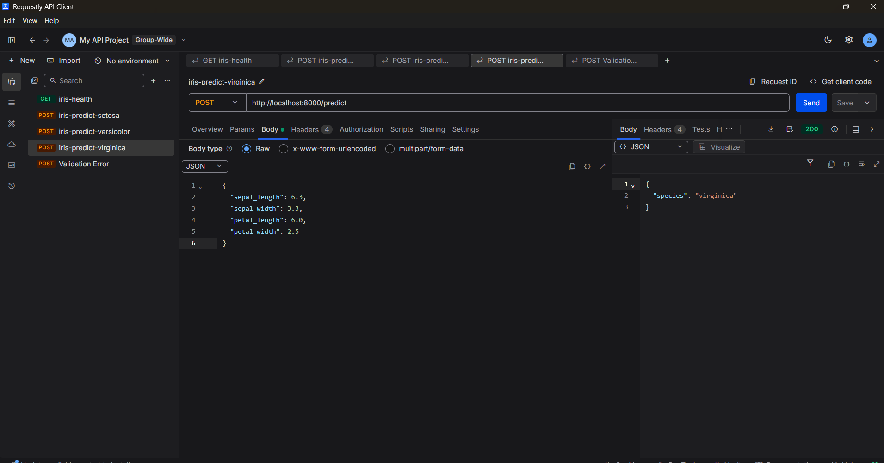
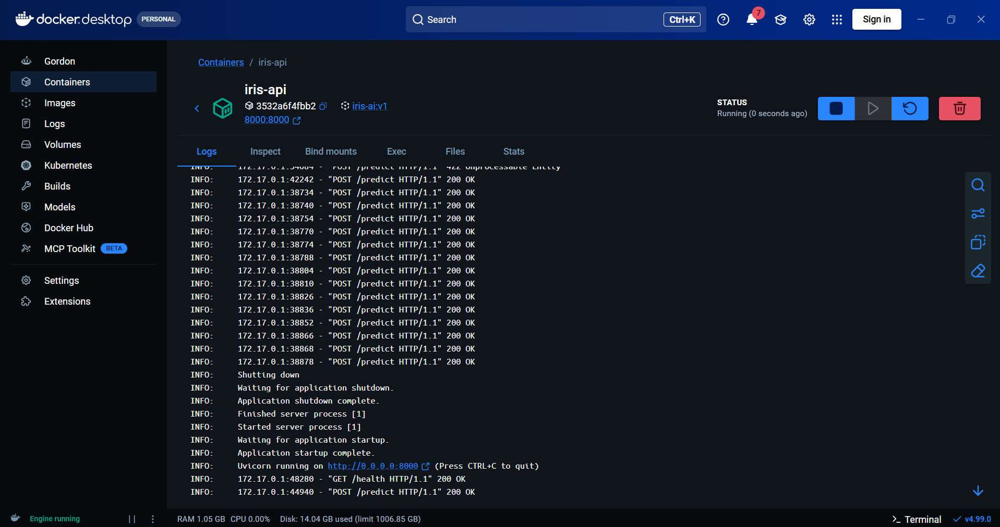
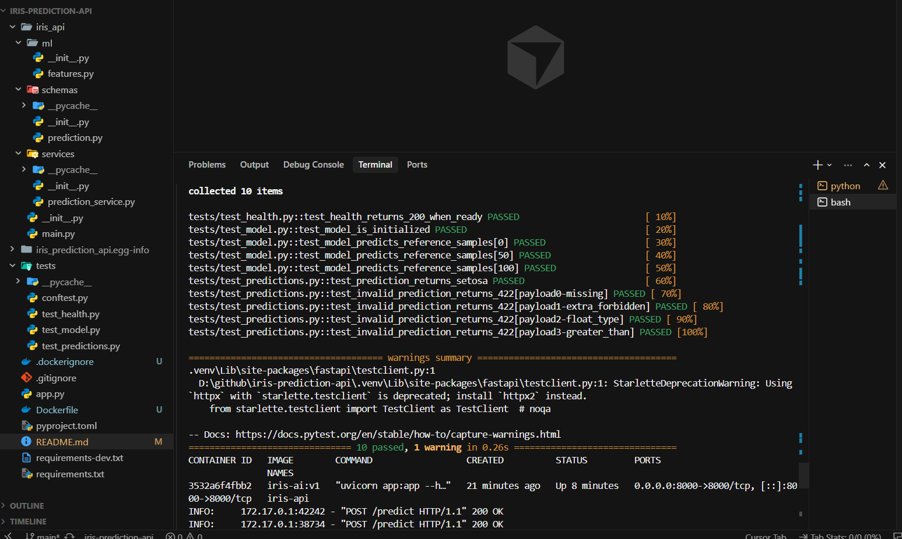

# Iris Prediction API

Containerized REST API that classifies Iris flower species from sepal and petal measurements using a scikit-learn Decision Tree model served with FastAPI.

## Features

- Train-on-startup Decision Tree classifier using scikit-learn’s built-in Iris dataset
- Typed request and response validation with Pydantic
- Health check endpoint for model readiness
- Interactive OpenAPI documentation (Swagger UI)
- Docker image for reproducible deployment
- Automated test suite with pytest

## Technology Stack

| Component   | Choice                          |
|------------|----------------------------------|
| Language   | Python 3.11                      |
| API        | FastAPI, Uvicorn                 |
| Validation | Pydantic                         |
| ML         | scikit-learn (`DecisionTreeClassifier`) |
| Testing    | pytest, httpx                    |
| Packaging  | Docker (`python:3.11-slim`)      |

## API Reference

Interactive docs: [http://localhost:8000/docs](http://localhost:8000/docs)

### `GET /health`

Returns whether the trained model is loaded and ready to serve predictions.

| Status | Body |
|--------|------|
| `200`  | `{ "status": "healthy" }` |
| `503`  | Model not available |

### `POST /predict`

Predicts Iris species from four numeric features.

**Request**

```json
{
  "sepal_length": 5.1,
  "sepal_width": 3.5,
  "petal_length": 1.4,
  "petal_width": 0.2
}
```

**Success (`200`)**

```json
{
  "species": "setosa"
}
```

Possible species values: `setosa`, `versicolor`, `virginica`.

Invalid or incomplete payloads return `422 Unprocessable Entity`.



## Project Structure

```text
.
├── app.py                 # Entry point; trains model during lifespan
├── iris_api/
│   ├── main.py            # FastAPI application factory
│   ├── api/               # Routers, endpoints, dependencies
│   ├── schemas/           # Request/response models
│   ├── services/          # Prediction business logic
│   └── ml/                # Feature preparation helpers
├── tests/                 # Automated API and model tests
├── Dockerfile
├── requirements.txt
└── requirements-dev.txt
```

## Getting Started

### Prerequisites

- Python 3.11+
- pip
- Docker (optional, for containerized runs)

### Local development

```bash
python -m venv .venv
source .venv/Scripts/activate   # Windows (Git Bash)
# source .venv/bin/activate     # macOS / Linux

python -m pip install -r requirements-dev.txt
python -m uvicorn app:app --host 127.0.0.1 --port 8000
```

The API listens on `http://127.0.0.1:8000`.

### Docker

```bash
docker build -t iris-ai:v1 .
docker run -d --name iris-api -p 8000:8000 iris-ai:v1
```

Useful container commands:

```bash
docker ps
docker logs iris-api
docker stats --no-stream iris-api
docker stop iris-api
docker start iris-api
```




## Testing

```bash
python -m pytest -v
```

The suite covers health readiness, model initialization, sample predictions, and request validation. Ten tests are expected to pass.

> Training-sample checks confirm wiring and basic correctness; they are not a measure of generalization on unseen data.



## Design Notes

- The classifier is trained in memory at application startup and held on `app.state` for the process lifetime.
- No external database or persisted model artifact is required.
- Intended for educational demonstration of an ML-backed API and container workflow.

## License

This repository is provided for educational use as part of a Cloud Computing practical assignment.
